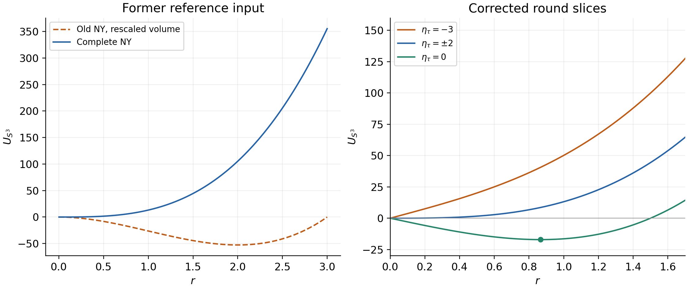

# 付録D. 改訂注と代表曲線

本版は完全NYの曲率側成分係数を1/2とし、大域体積と捩率の入力辞書を明示する。旧版における曲率恒等式とWeyl項の解析を、定理1–3の固定パラメータ分類として位置付ける。以下では代表式への影響を比較する。変分範囲と物理的解釈の限界は第9節に示す。

旧代表入力のコード値はVτ＝4、ητ＝−2、θ＝L＝κ＝1であり、幾何側ではV＝−4、η＝2となる。旧NY式と完全NY式を同じ現行体積へ揃えた比較を、式(REF)と図4の左に示す。

**式(REF)**

$$
U_{\mathrm{old,scaled}}(r)=\frac{4\pi^{2}}{3}r^{2}(r-3),
\qquad U_{\mathrm{corrected}}(r)=\frac{4\pi^{2}}{3}r^{3}.
$$

完全NY式は正半径で単調増加するため、旧式のr＝2極小は存在しない。旧掲載作用値にはさらに8倍の旧S³体積が使われていたので、成分係数の訂正と体積規約の変更を分けて読む必要がある。旧版のT³体積も現行の2π倍だった。図の右は第7節の4断面であり、ητ＝0の有限半径最小は別の固定パラメータ条件を具体化する。旧代表点の代替真空として扱うものではない。

左：旧NY式と完全NY式を同じ現行体積で比較（旧代表入力）。右：第7節の4入力に対応する等方断面。

本版の図1–4は現行式と明示した比較式から作成したもので、旧版の図1–12とは番号だけで対応付けない。
