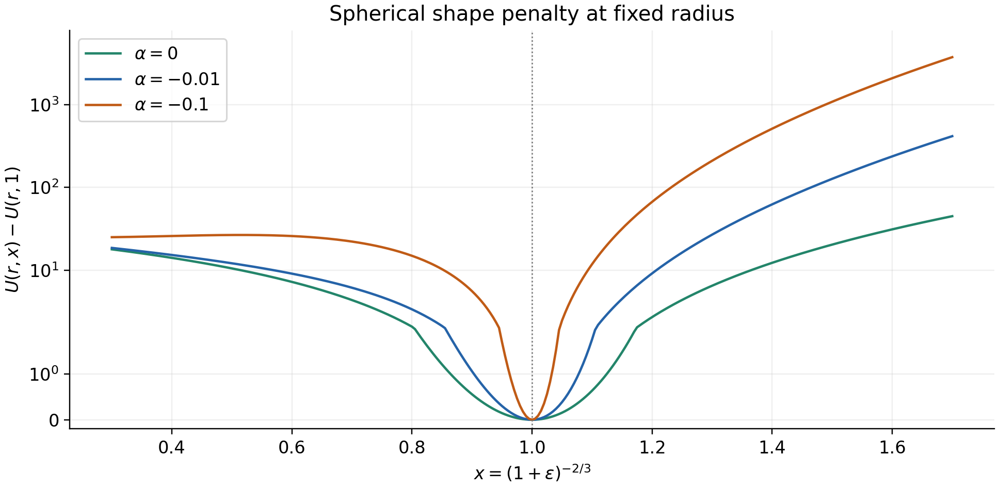

# 5. S³の形状差と大域最小

**定理1（非正結合での形状下限）**。 $`\alpha=-\beta\le0`$ 、固定L・κ・η・Vの下で、すべての正のr,xについて次が成り立つ。β＝0も含む。

**式(B)**

$$
\begin{aligned}
3-f(x)&=(x-1)^{2}(x^{2}+2x+3)\ge0,\\
U_{S^{3}}(r,x;-\beta)-U_{S^{3}}(r,1;-\beta)
&=\frac{c_{S^{3}}L}{3\kappa^{2}}(x-1)^{2}
\left[12r(x^{2}+2x+3)
+\frac{1024\kappa^{2}\beta x^{2}(x^{2}+x+1)^{2}}{r}\right].
\end{aligned}
$$

右辺の角括弧は正であるから、等号はx＝1の場合に限る。EC項と非負のWeyl項がともに等方断面の最小化に寄与する。α＝0ではWeyl罰則そのものは全形状で零だが、EC項が上の厳密な形状差を与える。

したがって全r,xの最小化は等方断面に帰着する。

**式(MIN)**

$$
\begin{aligned}
b&=9\eta^{2}-36,\qquad
U_{S^{3}}(r,1)=\frac{c_{S^{3}}L}{3\kappa^{2}}(V^{2}r^{3}+br),\\
r_{*}&=\frac{\sqrt{12-3\eta^{2}}}{\lvert V\rvert},
\qquad
U_{*}=-\frac{2c_{S^{3}}L V^{2}r_{*}^{3}}{3\kappa^{2}}
\quad(V\ne0,\ \eta^{2}<4).
\end{aligned}
$$

Vが非零でη²＜4なら、半径微分は負から正へ一度だけ変化するので、この点は一意な大域最小である。式(B)により形状方向にも一意である。r,εのHessianも次のとおり正定値である。

**式(H)**

$$
\begin{aligned}
H_{rr}&=\frac{2c_{S^{3}}L V^{2}r_{*}}{\kappa^{2}}>0,
\qquad H_{r\varepsilon}=0,\\
H_{\varepsilon\varepsilon}
&=\frac{c_{S^{3}}L}{3\kappa^{2}}
\left(64r_{*}+\frac{8192\kappa^{2}\lvert\alpha\rvert}{r_{*}}\right)>0.
\end{aligned}
$$

その他の退化・非達成・発散の場合は第7節に列挙する。大域最小という語は、この固定量と領域 $`r>0,x>0`$ に対する意味で用いる。

この最小が存在する領域では、等方でWeyl項が消えるため、半径と最小値は非正のαに依存しない。一方、式(H)の形状方向の二階微分はαの絶対値とともに増える。半径の選択と形状方向の復元的な曲率は、このように別々に読める。

S³の形状差。r＝L＝κ＝1。各曲線は固定rでのU(x)−U(1)で、非負性は式(B)から従う。
