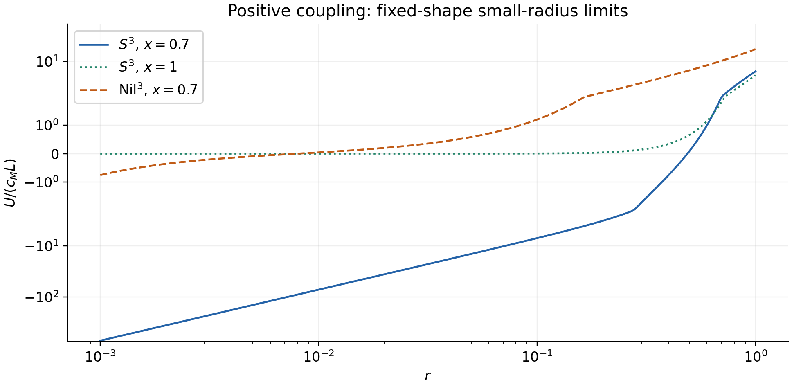

# 6. 正の結合と非有界性

**定理2（小半径での非有界性）**。α＞0なら、S³では任意の固定したx≠1、Nil³では任意の固定したx＞0で、Uはr→0において負に発散する。固定した有限のη,Vに依存しない。

**式(ASY)**

$$
\begin{aligned}
\lim_{r\to0^+}rU_{S^{3}}(r,x)
&=-\frac{1024c_{S^{3}}L\alpha}{3}x^{2}(1-x^{3})^{2}<0
\quad(x\ne1),\\
\lim_{r\to0^+}rU_{\mathrm{Nil}^{3}}(r,x)
&=-\frac{4c_{\mathrm{Nil}^{3}}L\alpha}{3}x^{8}<0
\quad(x>0).
\end{aligned}
$$

式(S3),(TN)のrおよびr³に比例する項は小半径で消え、逆半径項の係数は上の条件で負となる。したがって固定した非等方 形状だけで非有界性を示せる。S³の等方断面ではこのWeyl項が消えるので、その半径依存と非等方方向の漸近を分けて扱う。

図2は、同じ固定パラメータにおける等方と非等方の違い、およびNil³の小半径漸近を可視化する。有限点の曲線に対応する全領域の結論は、式(ASY)から得られる。

正の結合での小半径挙動。Vτ＝4、ητ＝−2、L＝κ＝1、α＝0.01、x＝0.7。有限点の曲線は式(ASY)の証明の例示である。
