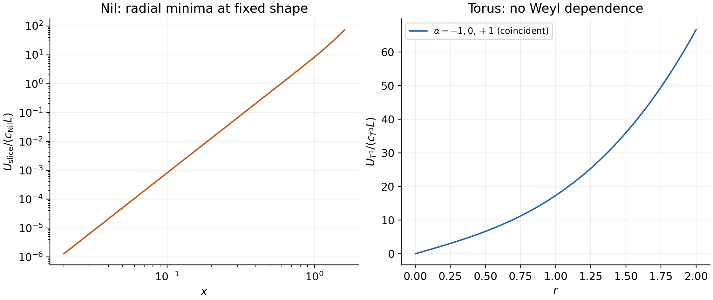

# 8. T³・Nil³との比較

T³ではLC-Weylが零で、完全NYも零である。Uはα,θ,形状に依存せず、V,ηのいずれかが非零なら半径に対して単調増加、下限0は未達成である。形状に依存しないのは平坦性だけによるのではなく、式(T)の軸性成分が形状に依存しないためである。V＝η＝0ならUは全域で零となり、形状や半径を選ぶことはできない。

Nil³ではα≤0に対し次が成立する。

**式(NIL)**

$$
\frac{\partial U_{\mathrm{Nil}^{3}}}{\partial x}
=\frac{c_{\mathrm{Nil}^{3}}L}{3\kappa^{2}}
\left(3x^{3}r+\frac{32\kappa^{2}\beta x^{7}}{r}\right)>0
\qquad (\alpha=-\beta\le0).
$$

ゆえに有限形状の二変数最小は存在しない。Uは正であるが、固定した正の長さℓを用い $`r=\ell t,x=t`$ 、 $`t\to0^+`$ とすれば下限0へ近づく。α＜0で形状を固定した場合には、これと別に半径の極小が存在する。

**式(SLICE)**

$$
\begin{aligned}
A&=V^{2},\quad B=9\eta^{2}+\frac34x^{4},\quad D=4\kappa^{2}\beta x^{8},\\
r_{\mathrm{slice}}^{2}
&=\frac{2D}{B+\sqrt{B^{2}+12AD}}
\qquad (\beta>0).
\end{aligned}
$$

この式はA＝0も含み、β＝0には適用しない。形状を解放すれば式(NIL)の方向へさらに下がるため、この極小は全二変数の最小ではない。α＞0では定理2が適用される。

左：Nil³の固定形状半径極小の値と未達下限への接近（α＝−1）。右：T³のα非依存。Vτ＝4、ητ＝−2、L＝κ＝1。
同じ固定コード振幅Vτ＝4、ητ＝−2では、非正αに対して三幾何とも下限0であり、いずれも有限内部点で達成しない。この入力は、最小が達成されない場合の三幾何の比較例となる。V≠0、η²＜4ではS³の負の達成最小と他二者の下限0という限定された比較は成立するが、これは選んだ商と固定振幅経路の結果であり、普遍的なトポロジー選択則ではない。Nilの局所曲率が形状極限で零へ近づくことも、コンパクト商そのものがT³へ変わることを意味しない。
